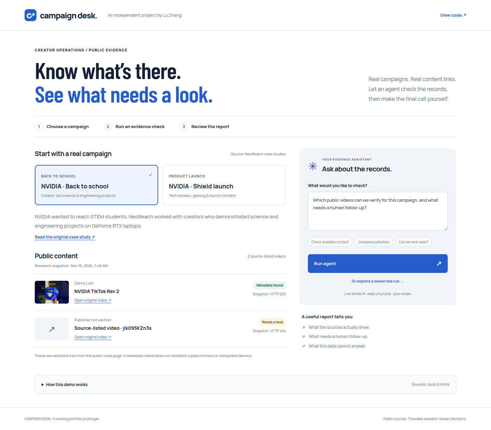

# Campaign Desk

A working public-evidence workflow for creator operations: choose a real NVIDIA campaign, inspect source-listed videos, ask an agent to check the records, and review its report.

[Live demo](https://creator-campaign-evidence-desk-1038659864130.us-central1.run.app) · [中文操作说明](docs/walkthrough.zh.md) · [Architecture](docs/architecture.md)



## Try it

1. Select **NVIDIA · Back to school**. The screen shows a dated research snapshot of two YouTube links embedded in NeoReach's public case page.
2. Click **Run agent**. Vertex AI chooses read-only tools, queries SQLite, refreshes public metadata when needed and drafts a source-linked report.
3. Inspect the evidence, enter a review note and choose **Approve report** or **Keep for follow-up**. The decision persists for this browser's demo session.

For a quick preview, **explore a saved real run**. Saved results are explicitly dated and cannot be reviewed as a new live run. Try the Shield campaign for a larger content list, or ask **Can we rank sales?** to see a question the public data cannot answer.

## What is real

- The public [RTX campaign](https://neoreach.com/case-studies/nvidia-2/) and [Shield campaign](https://neoreach.com/case-studies/nvidia/) are the source of the briefs and seven selected YouTube links.
- Live checks call YouTube oEmbed. They return actual HTTP status and available title/publisher metadata; failures remain failures.
- Vertex AI performs real function calling in a LangGraph loop. A second structured model call assesses the draft, after deterministic citation checks.
- Each run uses an isolated SQLite snapshot with keyed upserts. Reports and visitor review decisions persist in a private Google Cloud Storage bucket in the hosted app.

This is an independent prototype, not a NeoReach/NVIDIA product or a customer implementation. A public page embed is an association, not proof of a contract. We do not have deadlines, payments, creator fees, orders, conversions or private analytics. HTTP 200 verifies metadata returned, not playback or contractual delivery. HTTP 404 is not proof of non-delivery or deletion. No video is downloaded or watched by the agent. The review role is a demo role, not enterprise SSO.

## Agent and tools

| Tool | Actual work |
|---|---|
| `read_campaign` | Read the selected source-attributed brief |
| `list_public_content` | Query content records in SQLite |
| `refresh_public_metadata` | Request allowlisted YouTube metadata and upsert this run's records |
| `read_data_limits` | Retrieve the missing-data and interpretation boundaries |

The model selects tools. LangGraph executes a bounded loop, followed by citation validation and a separate model assessment. Human review is a server-side state transition after the agent finishes. No tool sends messages, edits external campaigns or approves reports. A small structured dataset does not require a vector database; this project uses SQL retrieval.

## Run locally

Python 3.11+ and [uv](https://docs.astral.sh/uv/) are required.

```bash
uv sync
export GOOGLE_CLOUD_PROJECT=your-project
# Use existing Application Default Credentials:
uv run python scripts/run_local.py
# Or use a short-lived token from your existing gcloud login:
uv run python scripts/run_local.py --use-gcloud
```

Open `http://127.0.0.1:8194`. Without credentials, the catalog and recorded examples work; a live run requires Vertex AI access. The default model is `google/gemini-3.8-flash`, override with `MODEL_ID`. Local reports use `.local/`, excluded from Git. The `--use-gcloud` token expires; restart the local server when needed. Cloud Run uses its service account, not a pasted API key.

## Verify

```bash
uv run pytest -q
GOOGLE_CLOUD_PROJECT=your-project USE_GCLOUD_TOKEN=1 PYTHONPATH=. uv run python scripts/evaluate.py
uv run python scripts/browser_smoke.py --url http://127.0.0.1:8194
```

The live evaluation covers availability, publisher identity, unavailable sales data and an unsupported contract accusation. Full artifacts are under `reports/`; the small evaluation is not a general accuracy benchmark. Browser smoke checks include a real run, review persistence, visitor isolation and responsive layout. Model/provider or external-source failures must remain visible; there is no mock success fallback.

## Deployment and operations

`scripts/deploy.sh` builds and deploys to Cloud Run. It expects an Artifact Registry repository named `evidence-desk`, a runtime service account named `creator-desk` with Vertex access, and a private report bucket granting that account object read/write access. Set `CLOUD_PROJECT` and `REPORT_BUCKET` before running.

Hosted limits: max one Cloud Run instance, two concurrent agent runs, 60 global run reservations per UTC day and ten per visitor. GCS generation checks protect quota updates and review transitions. Reports are visitor-scoped and retained for about 30 days by bucket lifecycle. There are no embedded keys or browser-accessible cloud credentials. The public demo does not accept private customer data.

## Attribution and design

Public case studies: NeoReach. Video metadata/thumbnails: YouTube and respective publishers. Brand names belong to their owners. Original code is MIT licensed; that license does not relicense source content.

Workflow research considered [Postiz](https://github.com/gitroomhq/postiz-app) and [InfluenceX](https://github.com/oratis/influencex). No source code was copied from either. Vertex credential plumbing was adapted from Lu Zhang's own evidence-agent project. Paper MCP creation was attempted but blocked by its weekly quota; the interface was implemented directly from the documented [design brief](docs/design/brief.md).
