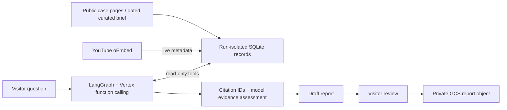

# Architecture and handoff

## Data boundaries

`app/data/catalog.json` contains curated brief summaries, source URLs, capture dates and seven observed video records. This is a dated public-source import, not a live NeoReach API connection. A live run refreshes the allowlisted video metadata when the model selects that tool. It does not discover arbitrary new videos or rescrape the case page.

`Records` creates a SQLite snapshot for each run. `video_id` is the primary key. Repeated refreshes upsert rather than duplicate. Failed refreshes clear title/publisher fields for that observation, preventing stale success data from being labeled live. Other runs and previously approved reports retain their own observations.

Publisher display names are not merged across platforms. We have video IDs and public author URLs but have not connected the authenticated YouTube Data/Analytics APIs or a creator CRM. oEmbed does not expose views, likes or sales.

## Agent control

The model selects zero-argument functions scoped by the server to the selected campaign. The network tool only calls a fixed YouTube endpoint with video IDs from the curated catalog. No user-provided URL, SQL or shell command is executed. A run has at most five agent rounds; tool batches are bounded; public-source requests have timeouts and one transient-error retry.

Required source context must be read before the report passes checks. Every finding must reference returned evidence. A separate structured model assessment evaluates semantic support, but it is fallible. Assessment failures and invalid citations block approval. Follow-up remains available. The model cannot execute the review endpoint.

## Review and persistence

The browser receives an HttpOnly, SameSite=Strict random session cookie; production uses Secure cookies. Reports are keyed under `reports/<unguessable session>/<run ID>`. Reads and reviews require that session. This is an anonymous demo boundary, not a verified staff identity. There is no global report-list endpoint.

Only `awaiting_review → approved` or `awaiting_review → follow_up` is allowed. GCS generation preconditions reject competing updates. The original report remains with its evidence snapshot and the human note. No external message, publication, payment or CRM update occurs. Browser localStorage keeps only the last run ID per campaign; the server holds the report. Clearing the cookie loses access to that session's reports.

GCS also holds a UTC-day reservation counter, updated with generation preconditions before model invocation. A failed run still consumes a reservation. Sessions can be reset by a visitor, so the global cap is the spending boundary, not a strong per-person identity limit.

## Operations

- Runtime: FastAPI/Uvicorn, one worker, Cloud Run; scale to zero, maximum one instance.
- Identity: dedicated `creator-desk` service account, Vertex user role and access to the dedicated private report bucket; no service account key files.
- Storage: private bucket, public access prevention, uniform access, approximately 30-day lifecycle for demo reports and budget objects.
- Health route checks process liveness only. A successful health response does not prove external model or YouTube availability.
- Errors: browser receives a useful generic error; logs record exception class without credentials or raw question bodies.
- Reproduce an issue with the source timestamp, campaign ID, run ID, model name and returned evidence, not just its answer text.
- To update case inputs, inspect the original page and preserve source association/capture date. Do not add guessed creator contracts or synthetic sales under real creators' names.
- Roll back by moving Cloud Run traffic to a previous revision. GCS object structure is append-only per new run; the current release introduces no destructive migration.

## Scope still outside this prototype

Live marketing/CRM integration, OAuth channel ownership, real client contracts or financial attribution, enterprise identity, role-based staff authorization, organization tenancy and a production audit/compliance program are not implemented. These are potential extensions, not resume claims.
